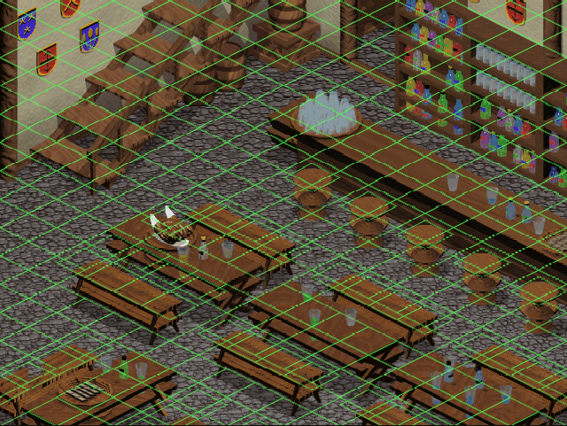
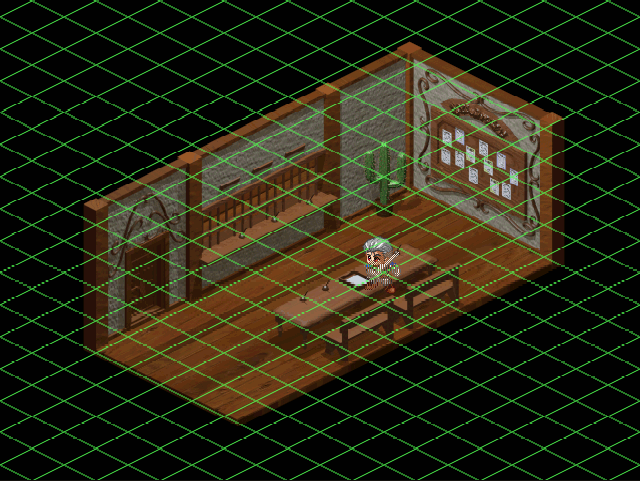

# 파랜드 택틱스 2 웹 리메이크 — 사용 설명서

이 문서는 원본 게임 데이터를 푸는 방법, 웹 자산으로 변환하는 방법, 뷰어와 분석 도구를 쓰는 방법을 설명한다. 설계 근거는 `docs/superpowers/specs/2026-10-14-rendering-foundation-design.md`에 있다. 파일 포맷은 `analysis/file_formats.md`에 있다.

## 1. 개요

### 1.1 프로젝트

- 원작: 파랜드 택틱스 2(FT2.exe, 1998). TGL의 Farland Saga 時の道標 한국어판. 640×480, 256색.
- 목표: 원본 데이터 파일을 그대로 읽어 브라우저에서 원작과 같게 그린다. 원작의 특이한 동작(예: 뒤집힌 회피 판정)도 그대로 둔다.
- 방식: Python이 원본 바이트를 풀어 PNG와 JSON으로 쓴다. TypeScript가 그 의미를 해석한다(애니메이션 스크립트 컴파일, 색 키, 그리기 순서).

### 1.2 진행 상태

| 하위 프로젝트 | 내용 | 상태 |
|---|---|---|
| 1 렌더링 기반 | 자산 변환, 맵·스프라이트 그리기, 애니메이션 재생, 개발용 뷰어 | 완료 |
| 2 전투 1판 | 유닛 배치·이동, 공격·마법 판정, 적 AI, 승패 (33개 전투 선택) | 완료 |
| 3 아이템·소지품 | 전투 중 아이템 사용, 보물 습득, 파티 소지품·장비 가방, 장비·상점 규칙 | 완료 (상점·장비 화면은 4에서) |
| 4 스크립트 VM | 이벤트 스크립트 실행, 대화, 마을, 상점, 스테이지 진행(`play.html`, §7) | 완료 |
| 5 세이브·사운드·UI | 세이브 호환, MIDI/WAV, 메뉴 | 예정 |

### 1.3 데이터 정책

- 원본 게임 파일(`*.egg`, `extracted/`)과 변환 결과(`web/public/assets/`)는 저장소에 넣지 않는다. `.gitignore`가 이 경로를 막는다.
- 사용자가 가진 원본으로 자기 컴퓨터에서 변환한다. 저장소에는 코드와 문서만 있다.

## 2. 준비물

| 항목 | 요구 | 확인 명령 |
|---|---|---|
| Python | 3.9 이상. 표준 라이브러리만 쓴다 | `python3 --version` |
| Node.js | 22.12 이상 (Vite 8과 Vitest 5의 요구) | `node --version` |
| npm | Node.js에 포함 | `npm --version` |
| 브라우저 | Canvas 2D, `DecompressionStream`, `ImageBitmap`을 지원하는 버전. Chrome 80, Firefox 113, Safari 16.4 이상 | |
| 원본 게임 | 분할 EGG 아카이브 `파랜드택틱스2.vol1.egg` ~ `.vol18.egg`, 또는 설치된 게임 폴더 | |

검증한 환경: macOS 26 (arm64), Python 3.14.6, Node 24.18.0, npm 11.

## 3. 설치

1. 저장소를 받는다. 모든 명령은 저장소 루트에서 실행한다. `web/` 안에서 실행하는 npm 명령만 예외다.
2. 웹 패키지의 개발 의존성을 설치한다.

```bash
cd web && npm install && cd ..
```

설치하는 패키지는 `typescript`, `vite`, `vitest`, `@types/node` 네 개뿐이다. 런타임 의존성은 없다.

## 4. 원본 데이터 준비

### 4.1 EGG 아카이브 풀기

원본은 ALZip EGG 형식의 분할 아카이브 18개다(암호 없음, 비솔리드). `tools/ft2_unegg.py`가 이 아카이브를 푼다.

1. 18개 `.egg` 파일을 저장소 루트에 둔다. 파일 이름을 바꾸지 않는다. 도구는 `.vol1.egg`의 이름으로 나머지 볼륨을 찾는다.
2. 내용을 확인한다.

```bash
python3 -I tools/ft2_unegg.py 파랜드택틱스2.vol1.egg
```

마지막 줄이 다음과 같아야 한다.

```
files: 5323, dirs: 0, total: 231,579,138 bytes, unparsed tail: 0 bytes
```

3. 아카이브를 푼다.

```bash
python3 -I tools/ft2_unegg.py 파랜드택틱스2.vol1.egg extracted
```

4. 아카이브는 `FarlandTactics2_Package.vol1` ~ `vol6` 여섯 폴더를 담고 있다. **vol1 폴더만 전체 1,704개 파일을 담는다.** vol2~vol6은 파일 일부만 담은 부분 사본이다(세이브 파일 3개만 내용이 다르다). vol1을 작업 폴더로 옮기고 나머지는 지운다.

```bash
mv extracted/FarlandTactics2_Package.vol1 extracted/FarlandTactics2
rm -r extracted/FarlandTactics2_Package.vol{2,3,4,5,6}
```

설치된 게임 폴더(`FT2.exe`가 있는 폴더)가 이미 있으면 그 폴더를 `extracted/FarlandTactics2`로 복사한다. 단계 2~4는 건너뛴다.

### 4.2 게임 폴더 구조

```
extracted/FarlandTactics2/
  FT2.exe        원본 실행 파일. 역공학 대상
  Map/           맵 76개 (stageNN.map) + 비트맵 213개 (배경 stNNa, 레이어 stNNb.., cloud/rain/snow)
  Sprite/        스프라이트 312개 (*.APD) + 시트 비트맵 418개
  DATA/          테이블 *.dat (race, item, magic, stage, desc), 이벤트 스크립트 EVENT*.dat
  bmp/           UI 비트맵 (얼굴, 창, 아이콘). 하위 프로젝트 5에서 쓴다
  Midi/ Wave/    음악 51곡, 효과음 107개. 하위 프로젝트 5에서 쓴다
  Save/          세이브 32개. 하위 프로젝트 5에서 쓴다
```

모든 `.bmp`와 `.map` 파일은 SZDD(MS-DOS COMPRESS) 압축이다. 도구가 읽을 때 자동으로 푼다. 사용자가 미리 풀 필요는 없다.

## 5. 웹 자산 변환

### 5.1 실행

```bash
python3 -I tools/ft2_export.py extracted/FarlandTactics2 web/public/assets
```

약 20초 걸린다. 끝나면 다음과 같이 출력한다.

```
maps 76, sprites 312, pngs 631, warnings 4, errors 0
warning: stage90.map: background st90a.bmp not found
warning: CHAR_29Z.APD: sheet char_29d.bmp not found
warning: breath_4.APD: sheet tornado.bmp not found
warning: char_11e.APD: sheet char_11e.bmp not found
```

경고 4개는 원본 배포판에 없는 파일이다. 변환기는 참조 이름을 JSON에 그대로 쓰고 PNG만 건너뛴다. 이 경고는 정상이다.

| 결과 | 종료 코드 | 뜻 |
|---|---|---|
| `errors 0` | 0 | 성공. 경고가 있어도 0이다 |
| `errors N` (N > 0) | 1 | 파서 검증 실패(이미지 RECT가 시트 밖, 패턴 번호 범위 밖 등). 메시지의 파일 이름을 확인한다 |

### 5.2 출력 구조

```
web/public/assets/
  index.json              { format: 1, maps: [76개 이름], sprites: [312개 이름] }
  map/stage02.json        맵: 크기, 배경·레이어 이름, 셀(높이, blocked, flag2, land, 오브젝트)
  map/st02a.png ...       배경과 레이어 이미지
  sprite/char_01a.json    APD: 시트 이름, 이미지, 패턴, 애니메이션 이름과 스크립트 원문
  sprite/char_01a.png ... 시트 이미지
```

- 모든 이름은 소문자 stem이다. 원본 `CHAR_01a.APD` → `char_01a`. 원본 `St02A.BMP` → `st02a`.
- PNG는 8비트 인덱스 PNG다. 팔레트 256색을 그대로 보존하고 투명(`tRNS`)이 없다. 투명은 렌더러가 색 키로 처리한다.
- 변환기 또는 파서(`tools/ft2_*.py`)를 바꾼 뒤에는 변환을 다시 실행한다. 출력은 덮어쓴다.

## 6. 전투 페이지

```bash
cd web && npm run dev
```

브라우저에서 http://localhost:5173/game.html 을 연다.

### 6.1 시작

1. **전투** 목록에서 하나를 고른다(33개, `번호 에피소드 — 목표`). 첫 항목이 원작의 첫 전투 "첫업무"다.
2. **시드**는 비워 두면 시각으로 정한다. 같은 시드와 같은 조작은 같은 결과를 낸다.
3. **시작**을 누른다. 파티는 새 게임 파티(카린·알, 로스터 1의 장비)에 고른 전투의 로스터를 적용한 것이다. 파티 레벨이 로스터보다 낮으면 로스터 레벨까지 올린다. 로스터가 (0, 0)에 둔 유닛은 이야기 스크립트가 배치하던 것이라, 파티원은 배치된 파티 옆에 두고 적은 뺀다(리메이크 편의 규칙).

### 6.2 조작

| 조작 | 동작 |
|---|---|
| 아군 유닛 클릭 | 선택. 이동 가능 셀(MOVE 타일)과 메뉴가 나온다 |
| 이동 → 셀 클릭 | 경로를 따라 달린다. 이동은 되돌릴 수 없다 |
| 공격 → 빨간 셀의 적 클릭 | 공격. 숫자 팝업과 로그 |
| 마법 → 주문 → 셀 클릭 | 시전. MP가 부족한 주문은 비활성. 전체 범위 주문(사이렌즈 등)은 시전자 칸에 표시된 한 타일을 클릭해 확정한다 |
| 아이템 → 항목 → 셀 클릭 | 소지한 소모품을 자신 또는 인접 아군에게 쓴다. 하나가 소비된다. 사용할 수 있는 소모품이 없으면 비활성 |
| 대기 | 유닛 종료 |
| 방향 화살표 클릭 / 유닛 클릭 / Enter | 행동 뒤 바라볼 방향. 배후·측면 판정에 쓰인다 |
| 오른쪽 클릭 / Esc | 한 단계 취소 |
| 턴 종료 | 적 페이즈. 모든 아군이 끝나도 자동으로 넘어간다 |
| 방향키·드래그·Shift | 뷰어와 같다 |

### 6.3 규칙 요약

- 유닛마다 턴에 이동 1회, 행동 1회. 이동력 30, 지형 비용은 종족표. 다른 유닛이 선 칸은 지나가지 못하고, 적 옆 칸에 들어가면 멈춘다(ZOC).
- 명중·크리티컬·회피는 민첩 비율, 방향(배후 ×2, 측면 +50 %), 상태로 정한다. 대미지 = 공격 − 방어, 속성·배율·높이 보정. 자세한 공식은 `analysis/battle_rules.md`.
- 적은 원작 AI 점수표로 움직인다(`analysis/field_mode.md` §5).
- 적 전멸 → 승리, 아군 전멸 → 게임 오버. 결과는 패널에 뜬다.

### 6.4 없는 것

이야기·대사, 마을·상점·장비 교체 화면, 세이브, 소리. 다음 하위 프로젝트에서 만든다.

### 6.5 보물과 소지품

- 보물(상자 오브젝트)이 있는 칸으로 이동하면 바로 줍는다. 골드는 파티 골드에, 소모품은 파티 소지품에, 장비는 그 유닛의 장비 가방(4칸)에 들어간다. 가방이 가득 차면 "더 가질 수 없다"가 뜨고 보물은 남는다.
- 숨은 보물은 파티 유닛이 인접하면 드러난다("보물 찾았다!").
- 패널의 소지품 절에 골드, 소모품(이름 ×개수), 파티원별 가방이 보인다.
- 전투 페이지는 시작 키트(골드 300, 허브 3, 해독초 2, 깨어나는 약 1)로 시작한다. 이것은 개발 페이지의 편의 기능이다. 실제 게임에서는 이야기 스크립트가 아이템을 준다.
- 장비 교체와 상점은 규칙만 구현되어 있다(`web/src/battle/equipment.ts`, `shop.ts`). 화면은 하위 프로젝트 4(마을·상태 화면)에서 붙는다.

## 7. 이야기 모드 (플레이 페이지)

```bash
cd web && npm run dev
```

브라우저에서 http://localhost:5173/play.html 을 연다. 원작 이벤트 스크립트(`EVENT00.DAT`…)가 게임을 처음부터 이끈다: 로고 → 오프닝 → 마을 → 시설 → 전투 → 다음 스테이지.

### 7.1 시작

1. 타이틀 화면에서 **새 게임**을 누른다. 소지금 200, 턴 −1(마을)에서 `EVENT00` 의 `begin` 라벨이 실행된다.
2. 로고 3장(각 4초)과 오프닝 대사가 이어진다. 대사는 **클릭** 또는 **Enter** 로 넘긴다. 클릭 1번이 대사 1번이다(연타해도 건너뛰지 않는다).
3. **전투 테스트** 링크는 §6 의 전투 페이지(`game.html`)로 간다. 두 페이지는 같은 전투 규칙과 패널을 쓴다.

### 7.2 조작

| 장면 | 조작 | 동작 |
|---|---|---|
| 대사 | 캔버스·대화창 클릭, Enter | 다음 대사 (`WAIT_CLICK`) |
| 메시지·질문 | 닫기 / 예 / 아니오 | 모달을 닫고 스크립트가 이어진다 |
| 마을 | 시설 위에 마우스 | 커서가 손 모양이 되고 하이라이트가 켜진다 (활성 시설만) |
| 마을 | 시설 클릭 | 그 시설의 스크립트(stage 파일 → 없으면 `EVENT00`) |
| 마을 | 빈 곳 클릭 | 모든 활성 시설의 하이라이트 켜기/끄기 |
| 마을 | 오른쪽 클릭 | 파티 메뉴(장비 교체) |
| 전투 | §6.2 와 같다 | 셀 클릭, 패널 버튼, 오른쪽 클릭·Esc 취소, 방향키·드래그 스크롤 |

### 7.3 마을

- 배경은 원작 `Town%02d.bmp` 레이어다. 낮/밤/어둠 세트는 스크립트가 고르고, 프레임 시트(깃발·물결·창문 불빛)는 50 ms 틱으로 움직인다.
- 시설은 15개(§`analysis/story_flow.md` 3.2). 스크립트가 `TOWN_FLAG_SET` 으로 켠 시설만 반응한다. 첫 마을에서는 여관과 길드가 열려 있다.
- 오른쪽 클릭 → **파티 메뉴**: 파티원의 레벨·HP·MP·장비·가방을 보고 **장착**/**해제**로 장비를 바꾼다. 상점에서 산 장비는 가방(4칸)에 들어오므로 여기서 장착한다.

### 7.4 전투와 스크립트 훅

- 스크립트의 `BATTLE_START` 가 §6 의 전투를 그 자리에서 시작한다. 파티·소지품은 이야기 전체에서 이어진다(상점에서 산 물건, 전투에서 얻은 경험치).
- 전투 중 원작 훅이 돈다: 행동 직전 `battle%02d`(대사 뒤 행동 수행), 대상마다 `BEAT`/`AFTER`/`ASSIST` 또는 `WIN`, 레벨업 `levelup%02d`, 승리 `COMPLETE`, 패배 `GAMEOVER`. 라벨이 없는 승패는 패널에 결과만 띄운다.
- 이름 있는 적(마크도갈·베히모스 등)의 시체는 스크립트가 치울 때까지 남는다(원작 규칙).

### 7.5 상점과 모달

- `SHOP` 은 품목·가격·보유 수를 보여 준다. **구매**는 소모품을 공용 소지품에, 장비를 선택한 파티원의 가방(4칸)에 넣는다. 판매는 아직 없다.
- `BATTLE_RESULT` 는 획득 골드와 레벨업을 보여 준다.

### 7.6 저장과 불러오기

- 세이브는 원작과 같은 `save%02d.dat`(6848 바이트)다. 원작 게임이 쓴 세이브를 **불러오기 → 가져오기**로 넣을 수 있고, **내보내기**로 받은 파일을 원작 `save\` 폴더에 넣으면 원작도 읽는다.
- 슬롯은 32개(00~31). 브라우저 저장소(IndexedDB)에 남는다. 사생활 모드처럼 저장소를 못 열면 그 페이지 안에서만 유지되고 안내가 뜬다.
- 자동 저장: 전투 시작 때 슬롯 30, 매 턴이 끝날 때 슬롯 31 (원작과 같다).
- **저장**: 마을에서 오른쪽 클릭 → 파티 메뉴 → **저장** → 슬롯을 고른다. 찬 슬롯은 덮어쓰기 확인을 한 번 더 묻는다. (원작 스크립트는 슬롯 30 자동 저장만 쓴다.)
- 불러오기 창에서 슬롯마다 **내보내기**·**삭제**가 있다. 가져오기는 빈 슬롯에 들어가고, 빈 슬롯이 없으면 덮어쓸 슬롯을 묻는다.
- 불러오면 저장된 스테이지의 `Restart` 라벨부터 이어진다(마을이면 마을, 전투 중이면 전투를 다시 세운다). 음악 번호도 되살린다.

### 7.7 소리

- 효과음은 원작 `Wave/*.wav`(107개), 음악은 `Midi/bgm%02d.mid`(25곡, GM 판)을 그대로 쓴다. 변환기(§5)가 `assets/wave`, `assets/midi` 로 복사한다.
- 음악은 브라우저 안의 MIDI 합성기(spessasynth)가 GM 사운드폰트로 연주한다. 사운드폰트는 저장소 밖이라 한 번 받아야 한다:
  ```bash
  python3 -I tools/ft2_soundfont.py web/public/assets     # FluidR3Mono_GM.sf3 (MIT, 약 14 MB) → assets/sf2/gm.sf3
  ```
  없으면 효과음만 나고 패널에 안내가 뜬다.
- 브라우저 정책 때문에 소리는 첫 클릭(새 게임·불러오기) 뒤에 켜진다. 그 전에 스크립트가 고른 곡은 기억했다가 켠다.
- 패널의 **음악/효과음** 슬라이더와 **음소거**는 브라우저에 기억된다. 탭을 숨겼다 돌아오면 음악이 이어진다.
- 원작 규칙: 효과음 채널 16개(`*` 접두 소리는 채널 0 고정), `MUSIC_FADE` 선형 페이드, 같은 곡은 다시 시작하지 않는다 [추정], 반복 재생 [추정]. GS 음원(`_gs.mid`)은 쓰지 않는다.

### 7.8 비주얼 씬

- 스크립트의 `PLAY_VISUAL` 이 부르는 원작 비주얼 씬 11개를 재생한다: 오프닝 무비(새 게임 직후, 18부 약 2분 20초), 이야기 중간의 장면 1·3·4·6·7·9·10·11, 엔딩 두 종(12·13). 원작의 장면 함수를 그대로 옮긴 타임라인(`web/src/visual/scenes/`)으로 그림·애니메이션·이동·페이드·효과음이 원작 시각에 맞춰 나온다.
- **건너뛰기**: 재생 중 화면을 클릭하거나 Enter 를 누르면 장면이 바로 끝나고 스크립트가 이어진다.
- 그림은 변환기가 만든 `assets/bmp/*.png` 와 장면 목록 `assets/data/visual.json`(원작 `vsllst.dat`) 을 쓴다. 변환기를 다시 돌리면 둘 다 갱신된다.
- 근사한 것 [추정]: 오프닝 5·7·9·12·14부의 등장인물 스프라이트 애니메이션(배경만 나온다), 디졸브(그냥 나타남), 13부의 흰색에서의 페이드 인(검정에서), 엔딩 12의 스태프 롤 글자(일곱 장의 크레딧 그림으로 대신), 엔딩 13의 자막과 팔레트 교차 페이드. 장면 2·5·8 은 어떤 스크립트도 부르지 않아 옮기지 않았다.

### 7.9 없는 것 (하위 프로젝트 5)

원작 비트맵 글꼴·창 틀·타이틀 메뉴 대신 HTML 오버레이를 쓴다. `MOVE_TO`(오프닝에서 1회: 차여 날아가는 연출)는 애니메이션의 이동 오프셋으로 재현한다. 상점에서 팔기, GS 음원(`_gs.mid`), 원작 Win32 대화상자 모양은 없다.

## 8. 뷰어

### 8.1 실행

```bash
cd web && npm run dev
```

브라우저에서 http://localhost:5173 을 연다. 종료는 `Ctrl+C`. 정적 빌드가 필요하면 `npm run build`를 실행한다. 결과는 `web/dist/`에 쓰이고 `public/assets/`도 함께 복사된다.

### 8.2 화면



- 왼쪽 패널: 맵·스프라이트·애니메이션 선택, 오버레이 체크박스, 상태줄, 오류창.
- 오른쪽: 640×480 캔버스. 창 크기에 맞는 정수 배율(1배, 2배, 3배 …)로 확대한다. 픽셀을 보간하지 않는다.
- 처음 상태: 맵 `stage02`, 스프라이트 `char_01a`, 카메라는 맵 중앙. 자산에 이 이름이 없으면 목록의 첫 항목을 쓴다.

### 8.3 조작

| 조작 | 동작 |
|---|---|
| 맵 선택 | 맵을 바꾼다. 배치한 스프라이트를 모두 지운다. 카메라를 맵 중앙에 둔다 |
| 스프라이트 선택 | APD 파일을 바꾸고 애니메이션 목록을 다시 채운다. 스크립트 컴파일 오류가 있으면 오류창에 표시한다 |
| 애니 선택 | 다음에 배치할 애니메이션을 고른다 |
| 셀 클릭 | 선택한 애니메이션을 그 셀에 배치한다. 여러 셀에 여러 개를 놓을 수 있다 |
| 반복 | 켜짐: 애니메이션을 반복 재생한다. 꺼짐: 한 번 재생하고 마지막 프레임에 멈춘다 |
| 배치 전부 지우기 | 배치한 스프라이트를 모두 지운다 |
| 캔버스 드래그 | 스크롤한다 |
| 방향키 | 16픽셀 스크롤한다. Shift+방향키는 64픽셀 |
| Shift (누르는 동안) | 투시 모드. 앞에 있는 오브젝트를 체크무늬로 그려 뒤의 유닛이 보인다(원작의 Shift 기능) |
| 격자 | 셀 마름모 윤곽을 초록색으로 그린다 |
| 높이 | 높이가 0이 아닌 셀에 높이 값을 적는다 |
| land | 지형 종류(land)별 색으로 셀을 채운다 |
| blocked | 이동 불가 셀을 빨간색으로 채운다 |



### 8.4 상태줄 읽기

```
cell (12, 17) h=2 land=1 blocked=0 flag2=0 objs=1
cam (352, 208)
F.ATTACK6#0/23
```

| 줄 | 뜻 |
|---|---|
| `cell (c, r) …` | 마우스 아래 셀의 대각 좌표 (c, r), 높이 `h`, 지형 `land`, 이동 불가 `blocked`, 미확인 플래그 `flag2`, 오브젝트 수 `objs` |
| `cam (x, y)` | 카메라 왼쪽 위의 맵 픽셀 좌표 |
| `이름#스텝/패턴` | 배치한 스프라이트마다 하나. 애니메이션 이름, 현재 스텝 번호, 현재 패턴 번호 |

### 8.5 좌표계 요약

- 셀 (c, r)의 기준점은 마름모의 중심이다. 화면 x = (c − r)·32 + originX, y = (c + r)·16 + originY − h·8.
- 그리기 순서는 대각 행 s = c + r 오름차순이다. 각 행에서 뒤 오브젝트(front = 0) → 스프라이트 → 앞 오브젝트(front ≠ 0) 순서다. 같은 행의 스프라이트는 배치한 순서다.
- 자세한 근거는 설계 문서 §7에 있다.

## 9. 검사

| 명령 | 실행 위치 | 내용 | 기대 결과 |
|---|---|---|---|
| `python3 -I -m unittest discover -s tools -p 'test_*.py'` | 루트 | 변환기 5개, EGG 추출기 3개 | `Ran 8 tests … OK` |
| `npm run check` | `web/` | `tsc --noEmit` 뒤 Vitest | 타입 오류 0, 테스트 전부 통과 |
| `npm test` | `web/` | Vitest만 | 테스트 전부 통과 |

- 코퍼스 테스트(`web/test/corpus.test.ts`)는 `web/public/assets/index.json`이 있을 때만 실행한다. 없으면 건너뛴다. 이 테스트는 맵 76개와 스프라이트 312개를 모두 읽고, 애니메이션 스크립트 3,065개를 컴파일해 오류 0을 확인한다.
- 셸 훅(rtk)이 명령 출력을 요약하는 환경에서는 `rtk proxy npm run check`로 원본 출력을 본다. 파이프(`| tail`)는 종료 코드를 가린다. `set -o pipefail`을 켜거나 출력을 파일로 보낸다.

## 10. 분석 도구 (명령줄)

모든 도구는 표준 라이브러리만 쓴다. 게임 파일은 신뢰할 수 없는 입력이므로 `python3 -I`(격리 모드)로 실행한다.

| 도구 | 용도 | 명령 |
|---|---|---|
| `ft2_unegg.py` | EGG 분할 아카이브 목록·추출 | `python3 -I tools/ft2_unegg.py FIRST.vol1.egg [OUT_DIR]` |
| `ft2_szdd.py` | SZDD 압축 풀기. `--png`는 8비트 BMP를 인덱스 PNG로 바꾼다 | `python3 -I tools/ft2_szdd.py [--png] OUT_DIR FILE...` |
| `ft2_map.py` | 맵 요약, `--json` 전체 덤프, 폴더를 주면 모든 맵 검증 | `python3 -I tools/ft2_map.py FILE.map [--json]` |
| `ft2_apd.py` | APD 요약(애니메이션 스크립트 원문 포함), `--json`, 폴더 검증 | `python3 -I tools/ft2_apd.py FILE.APD [--json]` |
| `ft2_tables.py` | DATA 테이블을 JSON으로 덤프. 종류를 생략하면 전부 | `python3 -I tools/ft2_tables.py GAME_DIR [race\|item\|magic\|stage\|desc] > out.json` |
| `ft2_event_disasm.py` | 이벤트 스크립트 디스어셈블. `-q` 요약 한 줄, `-r` 원시 바이트 | `python3 -I tools/ft2_event_disasm.py [-q] [-r] FILE...` |
| `ft2_export.py` | 웹 자산 변환 (§5) | `python3 -I tools/ft2_export.py GAME_DIR OUT_DIR` |

### 10.1 예

맵 요약:

```
$ python3 -I tools/ft2_map.py extracted/FarlandTactics2/Map/stage02.map
stage02.map: grid 25x30 (1446 cells), bg='St02A.BMP', layers=['St02B.BMP', 'St02C.BMP']
  view={'left': 0, 'top': 24, 'right': 49, 'bottom': 31} origin=(768, -384) pixel_size=(1344, 896) start=(0, -1)
  objects=75, heights 0..5
```

스프라이트 요약(애니메이션 이름과 스크립트 원문):

```
$ python3 -I tools/ft2_apd.py extracted/FarlandTactics2/Sprite/CHAR_01a.APD
CHAR_01a.APD: APD v3, sheets=['Char_01a.bmp', 'Char_01g.bmp'], 28 images, 30 patterns, 26 anims
  F.LIFT           'S50 P6 N8 M0,-8\r\nS50 P6 N8 M0,-16\r\n...'
  B.LEVITATE       'S200 P26-29'
  F.SET            'S200\r\nP1-3,2'
  F.DOWN_DAMAGE    'P7'
```

이벤트 스크립트 요약:

```
$ python3 -I tools/ft2_event_disasm.py -q extracted/FarlandTactics2/DATA/EVENT01.dat
extracted/FarlandTactics2/DATA/EVENT01.dat: size=12722 table_end=0xba symbols=17 instr=1248 db=0 unknown=0 unsupported_ext99=0 bad_sym=0 errors=0 OK
```

배경 비트맵 하나를 PNG로 보기:

```
$ python3 -I tools/ft2_szdd.py --png /tmp/ft2png extracted/FarlandTactics2/Map/St02A.BMP
```

## 11. 애니메이션 스크립트 빠른 참조

APD 파일의 각 애니메이션은 ASCII 스크립트다. 뷰어는 이 스크립트를 로드할 때 타임라인으로 컴파일한다(`web/src/sprite/animScript.ts`). 전체 규칙과 원작 함수 근거는 설계 문서 §8에 있다.

| 토큰 | 뜻 |
|---|---|
| `S<ms>` | 이후 프레임의 표시 시간(밀리초). 기본 200 |
| `P<목록>` | 패턴 번호 목록. 각 번호가 프레임 하나 |
| `<a>-<b>` | 범위. 방향은 양쪽 다 가능(`26-29`, `29-26`) |
| `N<n>` | 스텝의 프레임 수. 부족하면 앞 프레임을 돌려 채우고, 많으면 자른다 |
| `M<dx>,<dy>` | 스텝 전체의 이동량(픽셀). 두 번째 수가 스텝을 끝낸다. `M32-16`은 `M32,-16`과 같다 |
| `H`, `V` | 좌우·상하 반전. 숫자 바로 앞이면 그 프레임만, `P`·`M` 앞이면 토큰 전체(`HM`은 dx 부호 반전), `@` 앞이면 포함 전체 |
| `A`~`D` | 숫자 앞에 붙여 그 프레임에 표식 1~4를 단다 |
| `(n)`, `(#n)` | 숫자 앞에 붙여 그 프레임에 트리거 n을 단다. 숫자 하나가 지나면 지워진다 |
| `@<이름>` | 같은 파일의 다른 애니메이션 스텝을 포함한다 |
| 공백, `,` | 구분자. H/V 요소 비트만 지운다. 범위·표식·부호는 다음 숫자까지 남는다 |

예:

| 스크립트 | 결과 |
|---|---|
| `S50 P6 N8 M0,-8` | 패턴 6을 50 ms씩 8프레임. 스텝 끝에 (0, −8)만큼 이동 |
| `S200 P26-29` | 패턴 26, 27, 28, 29를 200 ms씩 |
| `P1-3,2` | 패턴 1, 2, 3, 2 |
| `PA(05)22- 24` | 패턴 22, 23, 24. 표식 A와 트리거 5는 22번 프레임에 붙는다. 공백은 범위를 지우지 않는다 |

스텝에 `P`가 없고 `M`만 있으면 앞 스텝의 프레임을 복사한다. 재생 규칙: 틱마다 프레임 하나씩 진행하고, 스텝이 끝날 때 이동량을 누적한다. 반복 재생은 처음으로 돌아갈 때 누적 이동량을 0으로 되돌린다.

## 12. 코드에서 모듈 쓰기

렌더러는 뷰어 없이도 쓸 수 있다. 다음은 맵 하나와 스프라이트 하나를 그리는 최소 코드다(`web/src/` 기준 경로).

```ts
import { AssetLoader } from './assets/loader';
import { MapModel } from './map/mapModel';
import { ApdModel } from './sprite/apdModel';
import { AnimPlayer } from './sprite/animPlayer';
import { Renderer, type Scene } from './render/renderer';

const loader = new AssetLoader();              // 기본 경로 'assets' (web/public/assets)
const renderer = new Renderer(canvas);         // 640×480 백버퍼를 가진 <canvas>

const mapData = await loader.map('stage02');
const layers = await Promise.all(mapData.layers.map((n) => loader.image('map', n)));
const bg = mapData.bg ? await loader.image('map', mapData.bg) : null;
const map = new MapModel(mapData, layers, bg);
await renderer.prepareMap(map);                // 레이어별 색 키 비트맵을 미리 만든다

const apdData = await loader.apd('char_01a');
const sheets = await Promise.all(apdData.sheets.map((n) => loader.image('sprite', n)));
const apd = new ApdModel('char_01a', apdData, sheets);   // 스크립트를 여기서 컴파일한다
await renderer.prepareApd(apd);

const player = new AnimPlayer(apd.anim('F.SET')!, { loop: true });
const scene: Scene = {
  map, sprites: [{ model: apd, player, c: 12, r: 17 }],
  camera: { x: 0, y: 0 },
  overlay: { grid: false, height: false, land: false, blocked: false },
  seeThrough: false,
};

function frame(now: number): void {
  player.update(now);          // 프레임·이동량 갱신
  renderer.draw(scene);        // 전체를 다시 그린다 (더티 사각형 없음)
  requestAnimationFrame(frame);
}
requestAnimationFrame(frame);
```

| 모듈 | 책임 |
|---|---|
| `assets/loader.ts` | 자산을 받아 검증하고 캐시한다. 실패는 `AssetError` |
| `assets/png.ts` | 8비트 인덱스 PNG를 팔레트와 인덱스 배열로 디코드한다 |
| `gfx/indexed.ts` | (이미지, 색 키) → RGBA `ImageBitmap` 캐시 |
| `iso/grid.ts` | 셀 ↔ 화면 좌표, 대각 행 순회, 마름모 피킹 |
| `map/mapModel.ts` | 맵 JSON을 행별 셀 목록으로 바꾸고 레이어 색 키를 정한다 |
| `sprite/animScript.ts` | 스크립트 → `Timeline` 컴파일. 실패는 `AnimScriptError` |
| `sprite/animPlayer.ts` | 시각에 따라 현재 프레임과 누적 이동량을 계산한다 |
| `sprite/apdModel.ts` | 패턴의 이미지 목록, 반전 배치, 그리기 명령 |
| `render/renderer.ts` | 장면을 640×480에 그린다. 투시 모드와 오버레이 포함 |
| `viewer/` | 개발용 뷰어 UI (`main.ts`), 배율·카메라 (`scale.ts`), 시작 순서 (`startup.ts`) |

## 13. 문제 해결

| 증상 | 원인 | 조치 |
|---|---|---|
| 오류창에 `assets/index.json: HTTP 404` | 자산 변환을 하지 않았다 | §5를 실행한다 |
| 오류창에 `not an asset index (format 1)` | 다른 버전의 변환 결과다 | 변환기를 다시 실행한다 |
| `char_11e`, `char_29z`, `breath_4`를 고르면 `… .png: HTTP 404` | 원본에 시트 파일이 없다(§5.1의 경고 3개) | 정상이다. 다른 스프라이트를 고른다 |
| `stage90`의 배경이 검다 | 원본에 `st90a.bmp`가 없다 | 정상이다 |
| 오류창에 `AnimScriptError: 이름@오프셋: …` | 스크립트 컴파일 실패. 원본 3,065개는 모두 통과하므로 수정한 파일일 때만 생긴다 | 메시지의 애니메이션 이름과 문자 오프셋을 보고 스크립트를 고친다 |
| 코퍼스 테스트가 `skipped` | `web/public/assets/index.json`이 없다 | 변환 뒤 다시 실행한다 |
| `npm install`이 Node 버전 오류를 낸다 | Node 22.12 미만 | Node를 올린다 |
| 화면이 작다 | 창이 작아 1배로 그린다 | 창을 키운다. 배율은 정수만 쓴다 |
| 방향키가 선택 상자를 바꾼다 | 선택 상자에 포커스가 있다 | 캔버스를 한 번 클릭한 뒤 방향키를 쓴다 |
| Shift를 떼도 투시가 남는다 | Shift를 누른 채 창 포커스를 잃었다 | Shift를 한 번 더 누른다 |
| 변환기가 Python 트레이스백을 낸다 | 손상된 원본 파일 | 트레이스백의 파일 이름을 확인한다. §4.1을 다시 한다 |

## 14. 알려진 제한 (하위 프로젝트 1)

- 맵 헤더의 `start` 필드 의미를 확인하지 못했다. 뷰어는 카메라를 맵 중앙에 둔다.
- 같은 대각 행에 놓인 스프라이트끼리는 배치 순서로 그린다. 원작의 정렬 키(+0x48)는 하위 프로젝트 2에서 다룬다.
- 팔레트 애니메이션과 페이드는 없다. 맵 팔레트 재배치(10..121 → 32..143)는 하지 않는다. 색은 같다.
- 스크립트의 트리거와 표식 값은 보존만 한다. 소비자(전투 코드)는 범위 밖이다.
- 원본 배포판에 시트 3개(`char_11e`, `char_29d`, `tornado`)와 배경 1개(`st90a`)가 없다.
- 소리, UI, 전투, 이벤트 스크립트 실행은 없다. 후속 하위 프로젝트에서 만든다.

## 15. 문서 지도

| 문서 | 내용 |
|---|---|
| `README.md` | 요약과 빠른 시작 |
| `docs/manual.md` | 이 문서 |
| `docs/superpowers/specs/2026-10-14-rendering-foundation-design.md` | 하위 프로젝트 1 설계. 색 키·셀 기준점·그리기 순서의 관찰 근거, 스크립트 문법(§8), 뷰어(§9) |
| `docs/superpowers/specs/2026-10-15-battle-foundation-design.md` | 하위 프로젝트 2 설계. 규칙 코어, 적 AI, 연출, 전투 페이지, 파티 규칙 |
| `analysis/field_mode.md` | 로스터 로딩, 유닛 스프라이트 규칙, 이동·사거리 표, 적 AI 점수표 |
| `docs/superpowers/plans/2026-10-14-rendering-foundation.md` | 구현 계획(13개 작업) |
| `analysis/report.html` | FT2.exe 역공학 분석 보고서 |
| `analysis/file_formats.md` | 맵·APD·테이블·세이브 파일 포맷 |
| `analysis/event_script_format.md` | 이벤트 스크립트 명령어 |
| `analysis/battle_rules.md` | 전투 규칙 |
| `web/README.md` | web 패키지 명령 |
